# Installing Arch (btw)

After extensive use of Debian, Fedora, and OpenSUSE Tumbleweed we will now look at a bit of a dark horse in the Linux community - Arch Linux.

Standard desktop distributions of Linux are designed to be a complete desktop operating system with minimal user configuration, providing a graphical installer similar to Windows and MacOS. As time passes, the inner tinkerer in some of us yearns for a more DIY/custom install to call our own. Arch is a great base for this.

The installation ISO is just a set of tools that you use to install the operating system, not a packaged installer like others. There is a learning curve and important concepts to learn that are transferable across other systems, this guide will take you through the following:

* Configuring a partition table for a Linux install on a UEFI platform.
* Create appropriate filesystems for each partition.
* Mount your partitions in the correct locations.
* Install the base operating system.
* Configure initial settings (timezone, location, hostname)
* Install and configure the GRUB bootloader.

Arch Linux is known for having one of the most broad and detailed Wiki sites in the Linux space, however I feel that for beginner users this is a barrier to installation. Once upon a time (10+ years ago) there was a beginners guide on the Wiki which has now been removed.

I will drop links to relevant pages on the [ArchWiki](https://wiki.archlinux.org) for additional details.

## Prerequisites

* [ArchLinux ISO](https://archlinux.org/download/) 
* USB flash drive if installing on a physical machine.
* A working network connect, test with `ping -c 1.1.1.1` before continuing.
* Time, patience, and a willingness to read.

## Partitioning the Disks

On booting the Arch Linux ISO image and confirming your network is up, the first order of business is to partition your storage drive. In this guide I will be using `fdisk` for task. 

First, identify the disk that you will be working on using the `lsblk` command. From this I can see a 32GB volume with the name `/dev/vda`. 

Now that I have this, I can run `fdisk` on this device in order to create my partitions.

```bash
fdisk /dev/vda
```

Once `fdisk` opens, enter the letter `p` and press enter to view details about the storage device: 

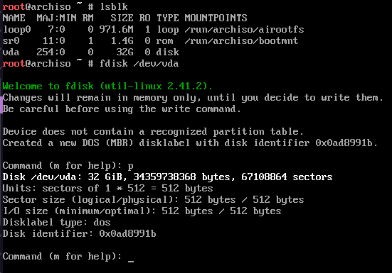

From this  I can see that my disklabel type is current set to `dos`, this is the older partition map standard with some limitations and compatibility issues with modern operating systems. 

We will change this to GPT by entering the letter `g` and then pressing *Enter*. Now that this is set we can start creating our disk partitions. 

For this install I will be creating three partitions. One for our boot files, a swap partition, and our root filesystem.

To create a new partition, press `n` then *Enter*, when prompted for :

* `Partition Number` - Press *Enter* for the next available number.
* `First Sector` - Where the partition starts on the disk, press *Enter* for the next avaiable storage block.
* `Last Sector` - Where the partition will finish, we want a 512Mb boot partition so we will type `+512M` here, then press *Enter*

Once created, this will default to the `Linux Filesystem` partition type, we want to change this to `EFI System` as it will contain our bootloader for our UEFI to start the operating system from. 

To do this, we type `t` followed by *Enter* to change the partition type, when prompted enter the number `1` and press *Enter* to change the partition type. 

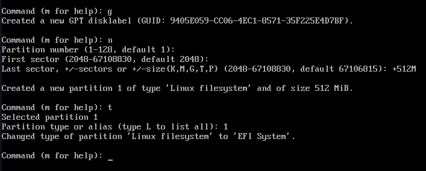

We will now create a further two partitions, one for our swap (space on disk if we run out of RAM) and one for our root partition:

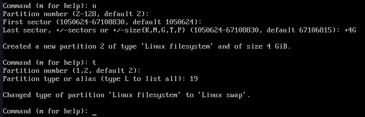

This time, when changing the partition type, we press *Enter* to select partition `2` , and set it to type `19` or Linux swap. In this example, I have created a 4Gb Swap partition. In actual deployments the rule of thumb is 2 x total memory if you want to use the hibernate function of Linux. Most systems in 2025 will be fine with between 8 and 16Gb of swap.

Finally, we will now create a root partition with the remaining space.

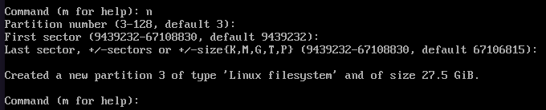

This time, we do not need to set a `Last sector` value or change the `partition type`.  Press `p` and then *Enter* to confirm your partition map looks correct:

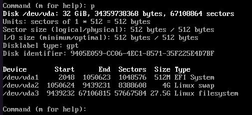

Assuming yours looks similar, press `w` to write changes to your disk. You can then confirm changes from the command line by typing `lsblk` again, you should now be able to see `vda`, `vda2`, and `vda3`.

## Formatting and Mounting Partitions

Now that we have our three partitions, we need to format them with a new filesystem and mount them in the correct locations before installing the operating system itself. 

### Formatting

We will first format our boot partition `vda1` , this must be in the FAT32 file format to allow it to be read by the UEFI of your motherboard. 

```bash
mkfs.vfat -F 32 /dev/vda1
```

Next, the swap partition:

```bash
mkswap /dev/vda2
```

And finally, we will format our root partition as `ext4`, this is Linux's most common filesystem - others are available with different benefits/functions.

```bash
mkfs.ext4 /dev/vda3 
```

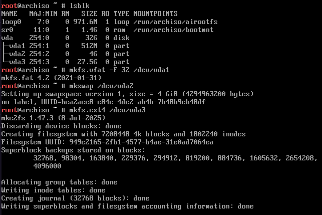

### Mounting Partitions

We will now mount the root and boot partitions, and enable the swap partition on our system ready for installation. 

First, we mount our root directory `vda3`:

```bash
mount /dev/vda3 /mnt
```

Next we will create a boot folder inside of our root directory and then mount the boot partition:

```bash
mkdir /mnt/boot

mount /dev/vda1 /mnt/boot
```

Finally, we will enable our swap partition:

```bash
swapon /dev/vda2
```

Once you have run these commands, you can verify everything is in the right place by running `lsblk` again:

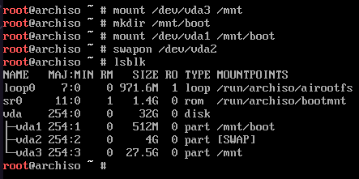

You are now ready to start installing the base operating system! Huzzah!

## Installing the base system.

Now that we have our disk partitioned and mounted, we can begin installing our operating system. This is a relatively short step:

```bash
pacstrap -K /mnt base base-devel linux
```

This command pulls in the `base`, `base-devel`, and `linux`, package sets and installs them. In a virtual machine this is the bare minimum that is needed to get the operating system up and running. It also creates a new GPG keyring to check the security verification for packages.

On physical hardware, especially newer hardware, you will likely need the `linux-firmware` package set to make sure that all devices (Wi-Fi, Video, Audio etc) work properly. Optionally, you can add either `amd-ucode` or `intel-ucode` depending on your CPU manufacturer.

## Configuring Your System

Now that you have all of the packages installed, we need to complete the system configuration to get things working correctly. 

### fstab

To get all of your partitions mounted on startup, the operating system will look at the `/etc/fstab` file to see what partitions need mounting, what filesystem they are, and where to mount them. Arch has an easy tool to get this done:

```bash
genfstab -U /mnt >> /mnt/etc/fstab
```

Then check the file created:

```bash
cat /mnt/etc/fstab
```

It should look something like this: 

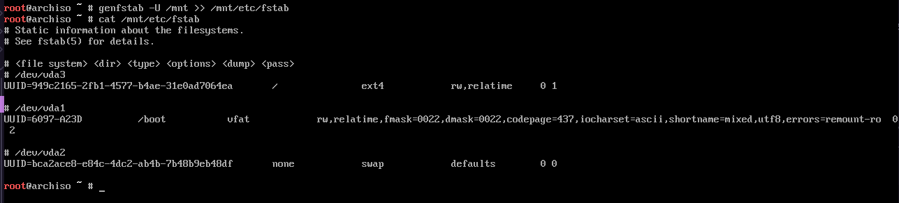

Your UUID values will be different to mine, this is a unique identifier to each partition created. Partitions *can* be mounted using `/dev/vda1` for example, however this can change if more drives are added or the SATA port they are plugged into changes.

### Chroot

We will now move into our new installation and configure the system from inside our new install and install nano for editing our files.

```bash
arch-chroot /mnt
```

```bash
pacman -S nano
```

### Setting our timezone.

We now select our timezone, our operating system will use this information for synchronising the time and date:

```bash
ln -s /usr/share/zoneinfo/Europe/London /etc/localtime
```

### Localisation

The system's locale/localisation ensures that we are seeing the correct formatting of text, symbols, and data. For example, this could be the position of commas in numbers, dates (DD-MM-YYYY), currency etc. 

First, open the `/etc/locale.gen` file using `nano`:

```bash
nano /etc/locale.gen
```

We will now uncomment (delete the # symbol) two locales, `en_GB.UTF-8 UTF-8` and `en_US.UTF-8 UTF-8`. Then save and exit the file (Ctrl + X).

Now update the locales:

```bash
locale-gen
```

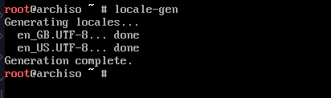

Next, set your preferred language/locale in the `/etc/locale.conf` file:

```bash
nano /etc/locale.conf
```

Add the following:

```bash
LANG=en_GB.UTF-8
```

Save and quit.

Finally, we will now set the keyboard layout for the CLI interface of our system by editing the `/etc/vconsole.conf` file:

```bash 
KEYMAP=uk
```

Save and quit. 

### Network Configuration

There are two files that need configuring to set your system hostname. 

First, edit the `/etc/hostname` file. This will be an empty file, just add your desired hostname then save and quit.

Next, open the `/etc/hosts` file using `nano`. Replace the `localhost` text with your hostname set in the previous file for both IPv4 and IPv6.

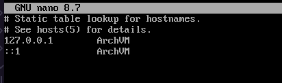

Now we will install our network management software and set it up to work on reboot, we will use `networkmanager` as it has become the standard across most mainstream Linux distributions. This just needs to be installed and its service enabled on boot:

```bash
pacman -S networkmanager

systemctl enable NetworkManager
```

### Root Password

Next, set a root password - Do not forget this or you will have a bad time.

```bash 
passwd
```

## Installing the Bootloader

In this guide, we will be using [GRUB](https://wiki.archlinux.org/title/GRUB) as our bootloader. It is very common across many distributions of Linux. 

First, install the `grub` and `efibootmgr` packages:

```bash
pacman -S grub efibootmgr
```

Next, we install the GRUB bootloader to our /boot partition:

```bash
grub-install --target=x86_64-efi --efi-directory=/boot --bootloader-id=grub
```

This should output `Installation finished. No errors reported.` If you get an error, review it and walk back through the partitioning/mount steps. 

Now that GRUB is installed, we can generate a new configuration file for the bootloader: 

```bash
grub-mkconfig -o /boot/grub/grub.cfg
```

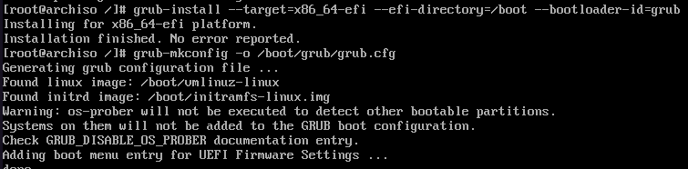

This command looks through the boot partition for the Linux kernel and any other files needed to boot the system and configures GRUB to show them as options when you boot up your machine.

## Rebooting

That's it! Now we need to exit out of our system, unmount the partitions and reboot:

```bash
exit

umount -R /mnt

reboot
```

Assuming all went well, you should now be greeted by GRUB with a boot entry for Arch Linux!

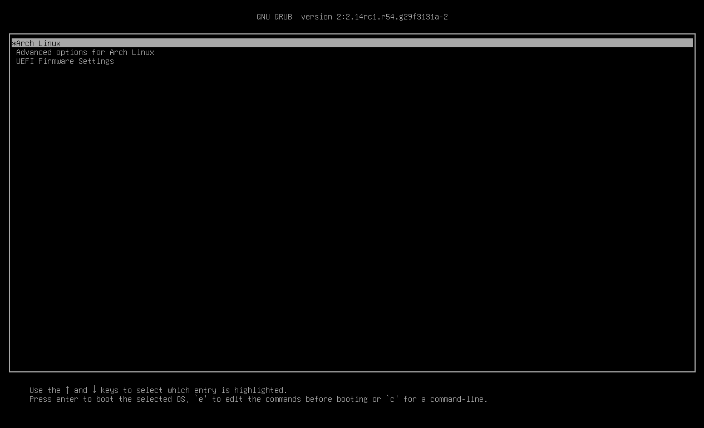

## Post Install

After boot, you can now log into your machine using the `root` user account and the password that you set during the installation process. Next steps can include:

* [Creating a user account](https://wiki.archlinux.org/title/Users_and_groups#User_management)
* [Installing and configuring `sudo` ](https://wiki.archlinux.org/title/Sudo)
* [Installing a desktop environment (Gnome, KDE etc)](https://wiki.archlinux.org/title/Desktop_environment)
* Basic applications - `firefox` `libreoffice` 
