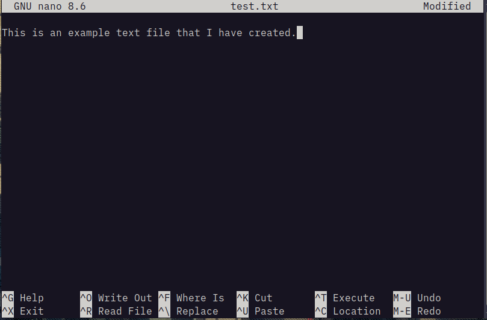
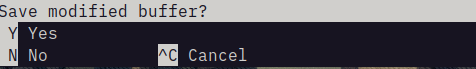
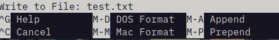
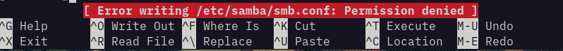

# The GNU Nano Text Editor

When interacting with lab computers, Proxmox, and Linux virtual machines you are going to need to edit a configuration file. In the Linux command line, we use a small program called Nano to do this. 
## Basic Usage

To open a file using Nano, simply type nano followed by the file name.

```bash
user@workstation ~ $ sudo nano test.txt
```



Remember, if you are editing a system configuration file, you will need to use the sudo (**S**ubstitute **U**ser Do**) program to run nano. For example, when editing a samba config:

```bash
user@workstation ~ $ sudo nano /etc/samba/smb.conf
```

## Saving and Exiting

Once you have finished making changes to your text file, press Ctrl + X:



Then press "Y" to confirm that you wish to save.



Finally, confirm the file name is correct and press enter. If needed, can rename the file at this stage. 

## Permission Denied

If you experience an error stating permission denied, it is likely that you are attempting to edit a file that requires administrative privileges, in the event of this, you will need to exit without saving (Ctrl + X, then "N") and re-edit the file with sudo. 


## Additional Information

More information about Nano and its many functions can be found both at the project's website, or in the manual files on your system:

* [Nano Editor Website](https://www.nano-editor.org/dist/v2.0/nano.html)
* Run the `man nano` command in your terminal.
