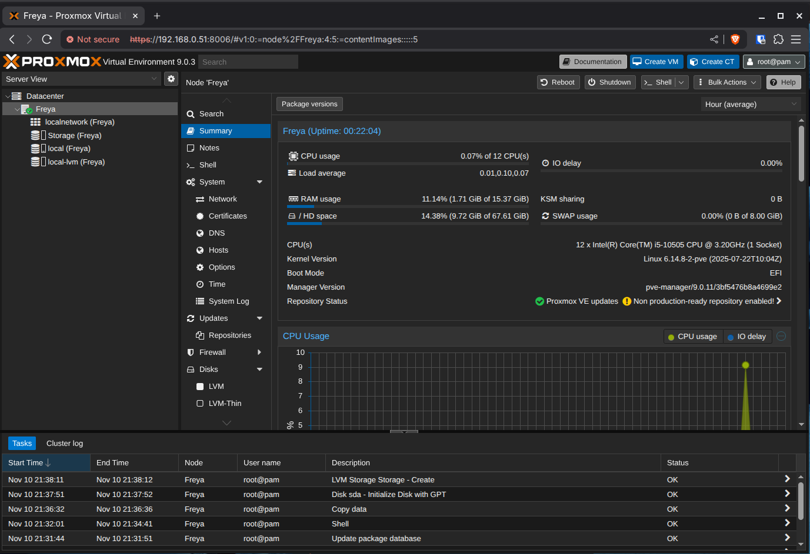
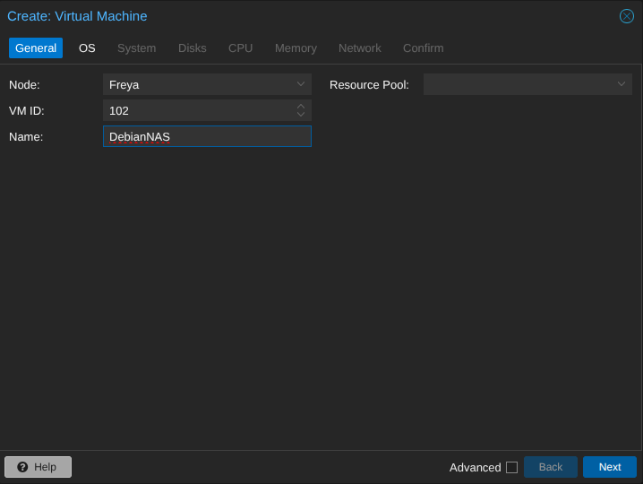
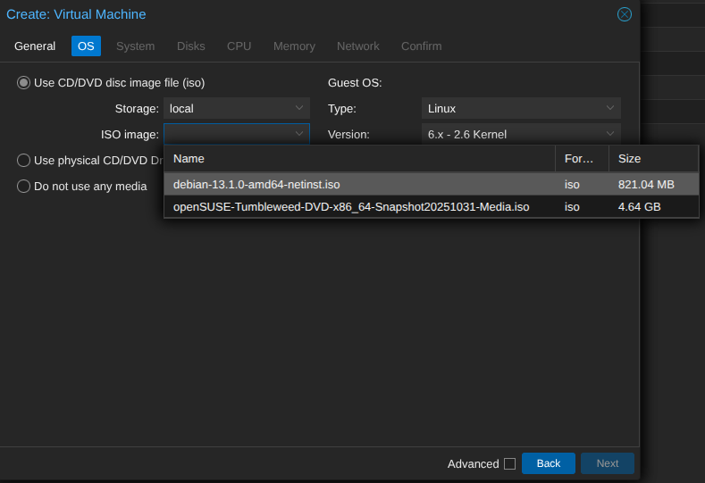
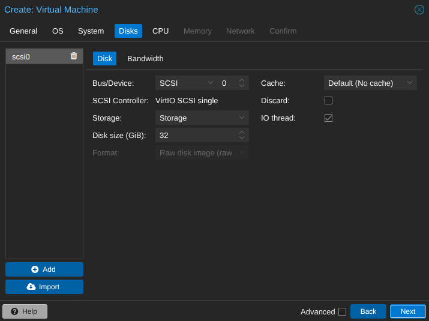
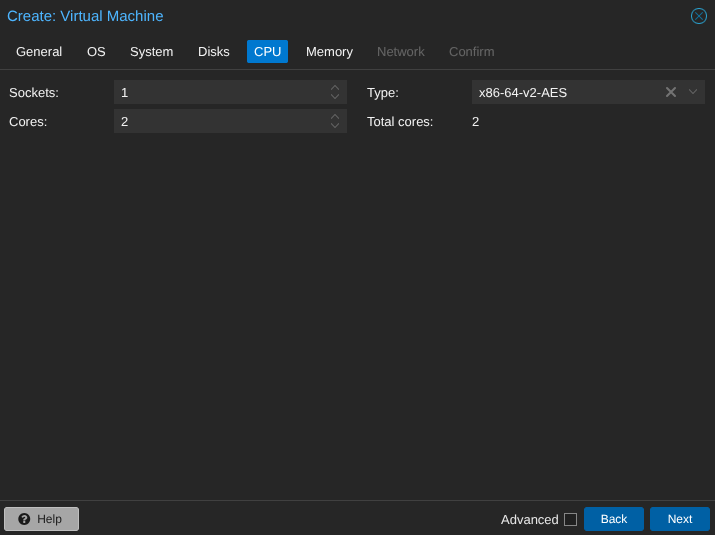
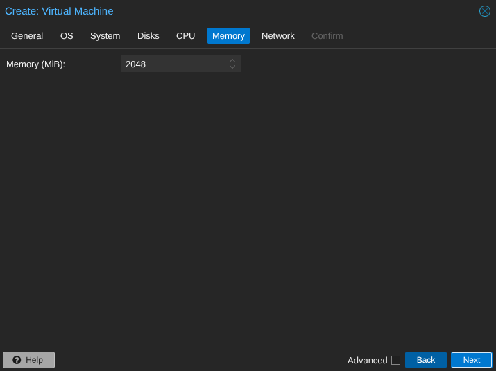

# Using Proxmox Virtualisation Servers

In the T-Lab, we have six servers running [Proxmox](https://www.proxmox.com/en/), a specialised operating system that allows us to run multiple virtual machines, we access and administer these servers from a web interface that is accessible on the lab machines and `TLevelTestNet` Wi-Fi network. 

IP addresses for these servers can be found in the T-Lab Network Schedule document available in Teams. You must add the port number for the web interface when typing the IP into your browser:

```http
http://192.168.1.55:8006
```

When prompted, login using the provided credentials. 

## Virtual Machines

Proxmox is an industry-grade piece of virtualisation software, and as such there are many tools and features that you can utilise. However for the majority of the tasks that we will undertake, it will be used as a host for our virtual machines. Here is the main interface of Proxmox 9:


### Creation

1. From the main interface of Proxmox, select *Create VM* from the top right-corner of the interface to open the creation interface.
2. Give your VM a name in the *Name* field. This should be unique to your machine, then click *Next*.



3. Next we will select our installation source, from the ISO Images drop down, select debian-13. Then click *Next*.



4. Leave the system settings at default, click *Next*.
5. Now we allocate storage for our virtual machine, we will leave this at the default 32GB. Click *Next*.



6. Now we can choose how many processor cores we are going to allocate our VM. Increase to two cores, then click *Next*.



7. Next is RAM allocation, we are going to provide our machine with 2GB. In this case we must provide it in megabytes - enter 2048, then click *Next*.



8. Leave all settings on the network tab as default, click *Next*.
9. Once you have verified the details, click *Finish*.

Your VM is now configured and ready to be started. You should see your VM appear in the *Server View*. 

For more information on virtualisation and resource allocation: [Virtualisation](../route-core/digital-environments/virtualisation.md)

### Managing

*To be completed*

### Deleting

*To be completed*
