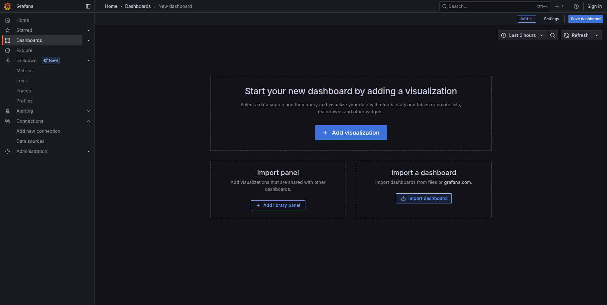
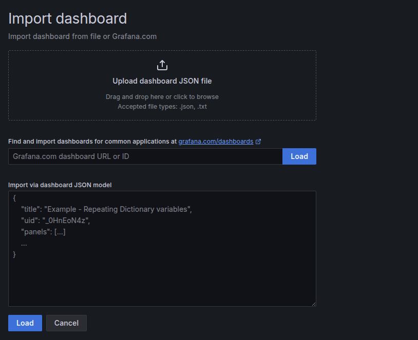
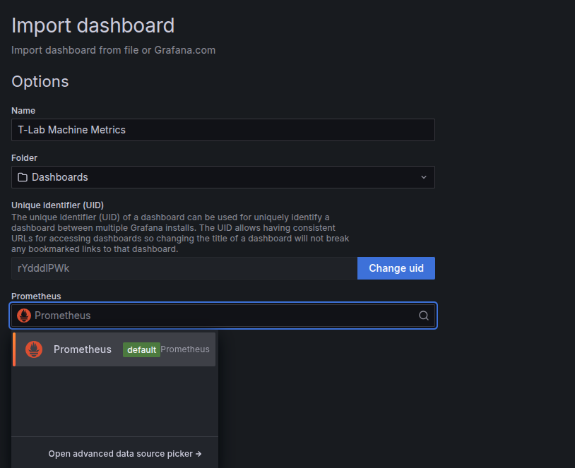
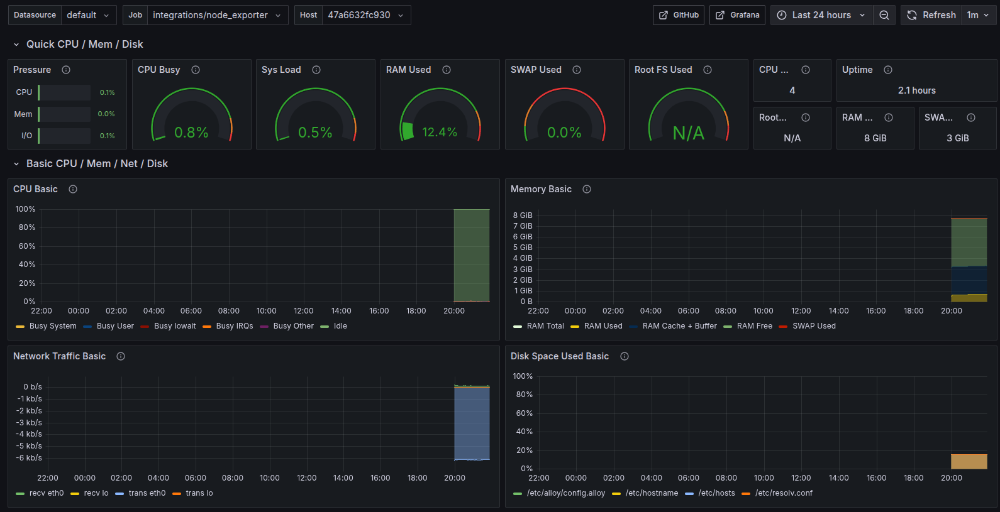
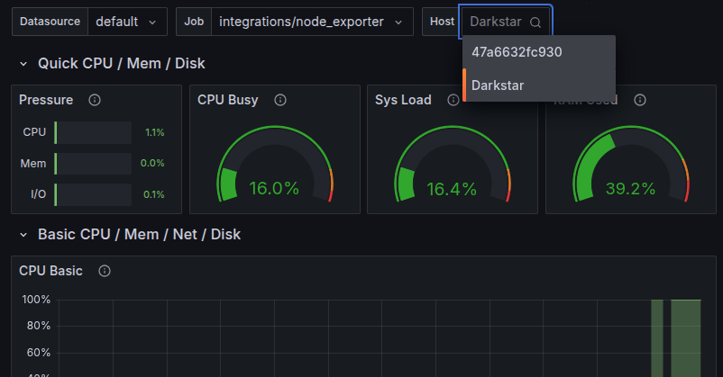
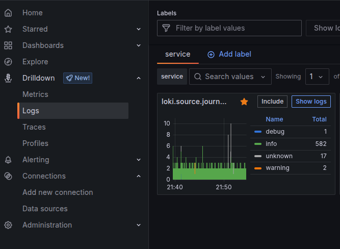
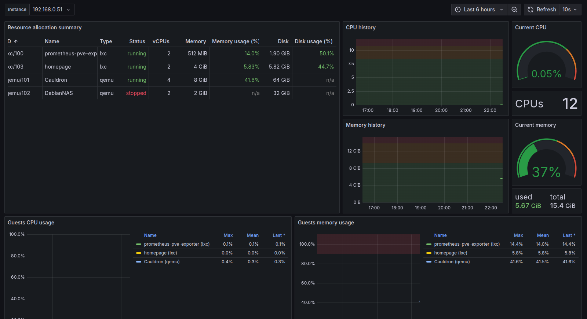

# Telemetry and Monitoring

In this practical activity, we will be configuring an industry-standard data collection and visualisation tool across the T-Lab network. Utilising several tools from the [Grafana Labs](https://grafana.com) software set. 

We will be utilising:

* Grafana Alloy - To send system metrics and log files from the client machine to the sever
* Grafana Prometheus - To collect the system metrics and store it
* Grafana Loki - To capture and store log files from client machines.
* Grafana Dashboard - To visualise data from Prometheus and Loki.

## Prerequisites

For this practical, we will be using Proxmox to host the Grafana collection services and bare metal installations of Alloy on T-Lab machines to collect data from each workstation. 

The Grafana monitoring stack runs in a docker container, so you will need an installation of Debian 13 Linux with Docker and Docker Compose installed. 

* [Installing Debian Linux for Server Use](../../misc/installing-debian-linux-for-server-use.md)
* [Docker and Containerised Applications](../digital-environments/docker-and-containerised-applications.md)

## Step 1 - Preparing the Monitoring Server

We will begin by setting up the Grafana monitoring stack on our Debian server machine, the stack runs in Docker so it is quick and easy to get up and running. All of the required configuration files can be found [HERE](https://codeberg.org/RDMillen/GrafanaOTEL)

From your Debian Server, we first need to install the `git` package to pull files from Codeberg:

```bash
sudo apt install git
```

Then clone the Codeberg repository:

```bash
git clone https://codeberg.org/rdmillen/GrafanaOTEL
```

This repo contains all of the configuration files needed. Move into the `GrafanaOTEL/ServerFiles/` directory:

```bash
cd GrafanaOTEL/ServerFiles/
```

Then start the container with Docker Compose:

```bash
sudo docker compose up -d
```

Grafana and Prometheus should now be accessible from your workstation's web browser on port 3000 for Grafana, and 9090 for Prometheus. 

## Step 2 - Install and Configure Alloy

These steps should be undertaken on your lab workstation. 

First, we need to install the Grafana Alloy application on Tumbleweed. The following steps add the signing key and repository containing the Grafana packages.

```bash
wget -q -O gpg.key https://rpm.grafana.com/gpg.key
```

```bash
sudo rpm --import gpg.key
```

```bash
sudo zypper addrepo https://rpm.grafana.com grafana
```

Now we can update the repositories and install Alloy:

```bash
sudo zypper update
```

```bash
sudo zypper in alloy
```

Now that Alloy is installed, we need to provide a configuration file. There is a sample config in the [GrafanaOTEL Repo](https://codeberg.org/RDMillen/GrafanaOTEL/src/branch/main/config.alloy). This file needs to be placed into the Alloy configuration folder located at `/etc/alloy`. 

A quick trick for this is to use curl to download the config to your workstation:

```bash
sudo curl https://codeberg.org/RDMillen/GrafanaOTEL/raw/branch/main/config.alloy > /etc/alloy/config.alloy
```

This command pulls the contents of the link, then outputs it to a file on your local disk. 

You now need to make a couple of modifications to the `config.alloy` file. Currently, a test IP address is listed in the config file. This IP address needs to be updated to the static IP address of your server VM running the Grafana Stack container. 

Once modified, you can bring the Alloy service up:

```bash
sudo systemctl start alloy
```

Then check it is running:

```bash
sudo systemctl status alloy
```

## Step 3 - Loading the Grafana Dashboard

In the [Codeberg repository](https://codeberg.org/rdmillen/GrafanaOTEL) there is a file called `test_dashboard.json`, download this file and navigate to the Grafana Dashboard hosted on your server. 

To access the dashboard, enter the static IP of your virtual machine with the container followed by port 3000. For example: `192.168.1.100:3000`.

Select *Dashboards* from the side pane, then *Import Dashboard*:



When prompted, upload the `test_dashboard.json` file.



Name the Dashboard, and select the Prometheus Data source:



Then click *Import*.



You will be presented with a rather snazzy dashboard, the default panel shown is the monitoring statistics of your server VM, to change the system that you are viewing, select a different machine from the *Host* drop-down menu:



To access logs collected by Loki, select *Drilldown* from the side panel, then click *Logs*: 



## Step 4 - Proxmox Monitoring

We are able to monitor workstations using Grafana Alloy, Proxmox is far more complex so we need to approach things a bit differently using a container called `prometheus-pve-exporter`. This container gathers information about the host machine, as well as statistics for each individual virtual machine:



`prometheus-pve-exporter` must be running on all of our Proxmox VE servers and reporting to a dashboard. We will finish by combining all of our data into one server to present. 

This is an independent task using the provided resources below to achieve the pictured dashboard. 

* [Prometheus-pve-exporter install script](https://community-scripts.github.io/ProxmoxVE/scripts?id=prometheus-pve-exporter&category=Monitoring+%26+Analytics)
* [Prometheus-pve-exporter GitHub](https://github.com/prometheus-pve/prometheus-pve-exporter)
* [Setting up Prometheus-pve-exporter with David McKone](https://www.youtube.com/watch?v=PtsdThgnZqs)
* [PVE Grafana Dashboard](https://raw.githubusercontent.com/mittelab/proxmox-via-prometheus-dashboard/refs/heads/main/proxmox-via-prometheus.json)

## Additional Resources

* [Official Grafana Alloy Documentation](https://grafana.com/docs/alloy/latest/)
* [Grafana Alloy Scenarios Repo](https://github.com/grafana/alloy-scenarios)
* [Grafana Alloy for Beginners](https://github.com/grafana/Grafana-Alloy-for-Beginners)
