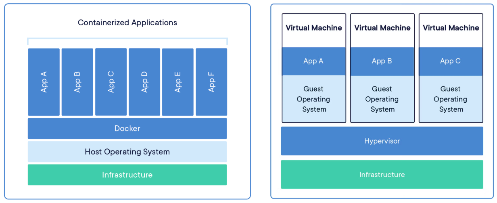

# Docker and Containerised Applications

Previously we have setup network services in virtual machines on Linux or through the Proxmox hypervisor. Virtual machines are great, they can be very resilient and an easy way to secure different services away from each other. However while they are great at this, they are not necessarily the most economical way of using your hardware. Each service would in theory run in its own VM with its own system resources and storage. 

Enter Docker. Docker is a way of running individual applications and services in isolation from the operating system in a way that gives it a heightened level of security but that also protects the host system from crashes. Each Docker container essentially isolates the main running of the program but allows small "hooks" into the host OS's kernel and resources. If there was  a crash, the app crashes and not the host OS.

Here is a really great diagram from Docker themselves:



Source: [Docker](https://www.docker.com/resources/what-container/)

What are we going to achieve by the end of this guidance?

- How to configure a APT based Linux operating system (Ubuntu / Debian) with Docker and Docker Compose.
- Creating your first containerised service.
- Managing containers
- Making a containerised service accessible to a machine on the local network.
- Securing the OS

This guide can be followed using a physical system (x64 or ARM64) based machine, virtual machine, or cloud VPS service. 

**To support with this activity, the below pages may be of use:**

* [Linux Package Management](../../misc/linux-package-management.md)
* [The GNU Nano Text Editor](../../misc/the-gnu-nano-text-editor.md)

## Part 1 - OS Installation and Configuration

1. Create a fresh installation of Debian 12. This machine should be a basic CLI installation without any GUI installed. If using a VM, I recommend using a minimum of 2 cores, 2048Mb of RAM. More intensive services, such as game servers, require more. 
2. A static IP must be assigned, you will need to identify your primary network interface name:

```bash
ip a
```

3. Using nano, open the interfaces file and customise with your network interface name (commonly ens18 in Proxmox), chosen static IP, and gateway details:

```bash
sudo nano /etc/network/interfaces
```

4.  Edit your interface, changing "DHCP" to "static". Then, add your desired IP address, including CIDR notation (e.g /24). Alongside the gateway (router) IP address:

```bash
iface YOURINTERFACE inet static
	address 192.168.1.75/24
	gateway 192.168.1.1
```

4. Press Ctrl+X, then "Y" to save the file.
5. Restart the networking services to update your IP address:

```bash
sudo systemctl restart networking
```

6. Check that your static IP has applied:

```bash
 ip a
```

---
## Part 2 - Installing Docker

For this guide, I will be using Debian 12 as my host operating system. The installation process of docker is slightly different for each Linux distribution, Docker maintains a superb set of documents on setting up the environment for each:

[Docker Installation Guides](https://docs.docker.com/engine/install/)

1. Ensure your system is up to date, then install ca-certificates and curl.

```bash
sudo apt update
sudo apt upgrade
sudo apt install ca-certificates curl
```

2. Next, we add the repository containing Docker's packages and add the security certificates to our package manager.

```bash
sudo install -m 0755 -d /etc/apt/keyrings
sudo curl -fsSL https://download.docker.com/linux/debian/gpg -o /etc/apt/keyrings/docker.asc
sudo chmod a+r /etc/apt/keyrings/docker.asc
```

3. Next, we need to add the Docker repository to Debian's package manager:

```bash
echo \
  "deb [arch=$(dpkg --print-architecture) signed-by=/etc/apt/keyrings/docker.asc] https://download.docker.com/linux/debian \
  $(. /etc/os-release && echo "$VERSION_CODENAME") stable" | \
  sudo tee /etc/apt/sources.list.d/docker.list > /dev/null
```

4. Next, we install Docker and its dependencies. 

```bash
sudo apt update
sudo apt install docker-ce docker-ce-cli containerd.io docker-buildx-plugin docker-compose-plugin
```

5. Enable the Docker service:

```bash
sudo systemctl enable --now docker
```

6. Verify that Docker is install by running the Hello World Image:

```bash
sudo docker run hello-world
```

---
##  Part 3 - Docker Containers

Docker applications are the individual applications, we then define how they will work together using Docker Compose and a "YAML" file. In Docker terms, this is known as a "Stack". 

Christian Lempa maintains a great [boilerplates repo on Github](https://github.com/ChristianLempa/boilerplates/tree/main/docker-compose) containing loads of example docker-compose.yaml files.

In this example, we will be setting up and instance of Nextcloud. A free, open-source cloud storage application that can be deployed on your own machine. There are apps available for iOS and Android to allow camera sync too!

Services like Nextcloud need a way of keeping track of all of the data and users accounts that are created during its usage, therefore we also need to run a database to store this information. The compose file below uses MariaDB for this purpose. 

1. On our server, we will first create a new directory for our stack's configuration files, then move into that folder:

```bash
mkdir nextcloud-docker
cd nextcloud-docker
```

2. Create your compose.yaml file:

```bash
nano compose.yaml
```

3. Add the following content to your YAML:

```bash
volumes:
  nextcloud:
  db:

services:
  db:
    image: mariadb:10.6
    restart: always
    command: --transaction-isolation=READ-COMMITTED --log-bin=binlog --binlog-format=ROW
    volumes:
      - db:/var/lib/mysql
    environment:
      - MYSQL_ROOT_PASSWORD=supersecretrootpassword
      - MYSQL_PASSWORD=Password123
      - MYSQL_DATABASE=nextcloud
      - MYSQL_USER=nextcloud

  app:
    image: nextcloud
    restart: always
    ports:
      - 8080:80
    links:
      - db
    volumes:
      - nextcloud:/var/www/html
    environment:
      - MYSQL_PASSWORD=Password123
      - MYSQL_DATABASE=nextcloud
      - MYSQL_USER=nextcloud
      - MYSQL_HOST=db

```

Docker Compose files are design to be very readable. We can break it down to see how there are two applications here with their own settings. Docker applications are combined into what we call a "stack". This is when there are multiple Docker applications that work together within a single container to provide the user a service. 

4. Save your docker-compose.yaml file, then start the container. The -d flag runs the container as a daemon (background service). If you are having issues getting the container running, execute the command without the -d flag to see the full debug log.

```bash
	sudo docker compose up -d
```

---
## Part 4 - Further Containerising

The world of Docker is massive. There are thousands of Docker images that you can deploy on your own machines/Raspberry Pi devices. I have collated a "Top" list, along with links to the example compose files!

### Top Self-Hosting Containers

1. [NextCloud](https://hub.docker.com/_/nextcloud) - An awesome, free and open source cloud platform. It has a boat load of features, native applications for EVERY platform, including iOS and Android. Reliable, self-hosted cloud service.
2. [PiHole](https://hub.docker.com/r/pihole/pihole) - PiHole is a DNS resolver for your home network, but with the added bonus that ad services don't get resolved! Huzzah! Yes, you could just use uBlock Origin or Adblock - BUT Google are actively disabling and removing ad blockers from Chrome AND PiHole also blocks advertising in mobile apps! 
3. [Wordpress](https://hub.docker.com/_/wordpress) - As of early 2024, Wordpress powers over 40% of the websites on the internet, that's over 810 million websites! No surpises as it it free, open source, and intuitive to use. Great for hosting personal blog sites, even large business pages! 
4. [SearxNG](https://hub.docker.com/r/searxng/searxng) - Searx is a "meta search-engine", it acts as a forwarder for your search queries and returns results from all search engines! It is a great tool for promoting personal privacy, but also filtering search results from only sources that you trust. Again, also free and open source! 
5. [Game Servers](https://github.com/GameServerManagers/docker-gameserver/tree/main/docker-compose) - Many, many games servers have Docker containers available. Game Server Manager is an amazing resource that you can use to run a game server for almost any online game service out there! Everything from Ark, Counterstrike, L4D, Minecraft and many more! Please note: Game servers can be more intensive to run than other services!
6. [Mumble Voice](https://github.com/mumble-voip/mumble-docker) - Discord is great and all that BUT it is both a resource hog and privacy nightmare. Chat with your friends like it's 2010 with Mumble. A chat server the focuses on low-latency, high-quality voice chat for gamers. No stickers, no memes, just the ability to yell at your team mates in crystal clear quality.
7. [Jellyfin](https://hub.docker.com/r/jellyfin/jellyfin) - A free and open source (notice a theme?) media organiser application. It allows you to stream and download your own media stored on a local server to all of your devices around your home. For iOS I recommend the [Streamyfin](https://apps.apple.com/us/app/streamyfin/id6593660679) app, Jellyfin's native app stinks. 

## Further Docker Resources

- [Docker Hub](https://hub.docker.com/)
- [LinuxServer](https://hub.docker.com/)
- [Docker Compose Guide](https://docs.docker.com/compose/)
