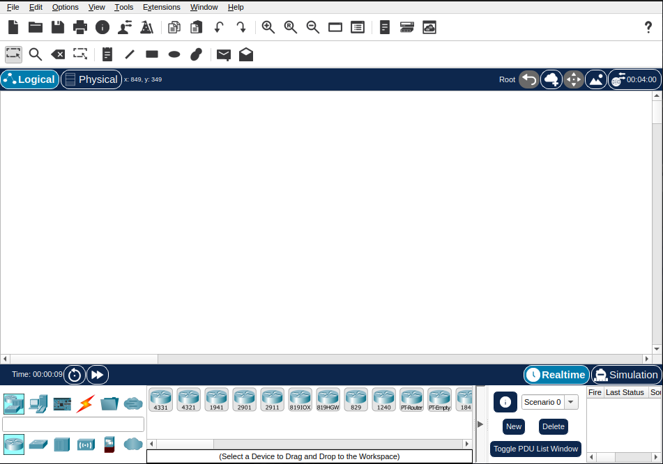

# Cisco Packet Tracer

## Introduction

**Cisco Packet Tracer** is a powerful network simulation tool that lets us build and test entire networks—from basic layouts to detailed hardware configurations. It provides a safe, flexible environment to practise setting up and managing networked devices without needing physical equipment.

With the new changes to the T-Level qualification, some of your assessed tasks will now take place in Cisco Packet Tracer. Getting familiar with the software early on will put you in a strong position for both your **Employer Set Project (ESP)** and **Occupational Specialism (OS)** assessments.

## Accessing Packet Tracer

The only requirement for using Packet Tracer is to create a [Cisco NetAcad](https://www.netacad.com) account and enrol on the [Getting Started with Packet Tracer](https://www.netacad.com/courses/getting-started-cisco-packet-tracer?courseLang=en-US) course. Once you’ve started the course, you’ll be given access to download the software. It’s a quick and straightforward process—and completely free.

When you open the software for the first time, you will have to sign in using your Cisco NetAcademy details. 

## The Interface

The interface is relatively simple, the main toolbar at the top of the screen allows you to manipulate objects in the main windows. The toolbar at the bottom of the screen contains devices and cabling options. 



As always, save your Packet Tracer session before you bring with an appropriate name. 

```
    File > Save As...
```

## Note

While the *Getting Started with Packet Tracer* course isn't a requirement to use the software, I highly recommend completing the course. It only takes an hour or so and goes through all of the essentials to get you started!

Guides on The DSS Wiki assume that you have completed the course and will not cover the absolute basics.
