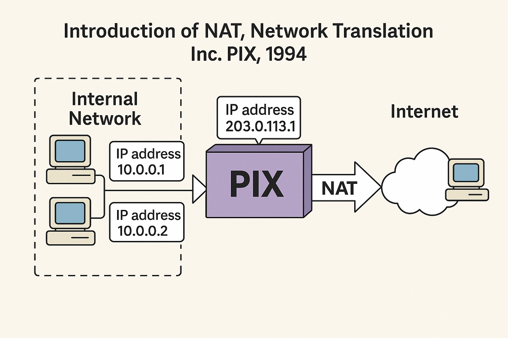
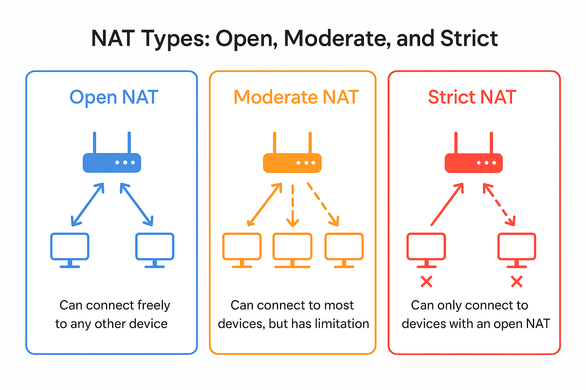

# Network Address Translation (NAT)

## Introduction

In the early days of the internet, every device online was assigned an IP address from a finite pool. Back in the late 1980s and early 1990s, there weren’t enough machines online for this to be a pressing concern. However, it was recognised even then that we would eventually run out of IPv4 addresses, and that a solution would be needed.

In 1994, Network Translation Inc. (NTI) developed a device that allowed an organisation to create an isolated "private" network—what we would now call a LAN—that could connect to the "public" network, or what we now refer to as the WAN. NTI introduced a networking device called the "PIX", short for _Private Internet eXchange_. Its purpose was to allow a single site to use one public-facing IP address while internally assigning a range of private IP addresses that would not conflict with other devices on the wider internet. All the organisation needed was a static IP for the PIX, provided by their internet service provider (ISP).

An unintended benefit of this setup was that it masked the IP addresses of internal machines, allowing the PIX to function as a basic firewall. In 1995, Cisco acquired Network Translation Inc. and continued developing the PIX product line into the early 2000s, placing greater emphasis on its security capabilities. The PIX was eventually succeeded by the Adaptive Security Appliance (ASA) series.

## Current Implementation

NAT is used in almost all modern networks. Even smartphones use NAT when connecting to a mobile carrier's network, helping to conserve the limited pool of available IPv4 addresses.

Home routers carry out NAT in the same way that the original PIX device did. They assign each device on the local area network a _private_ IP address and route outbound connections to the internet. Most home routers receive their public-facing IP address, either IPv4 or IPv6, through DHCP provided by the internet service provider (ISP).

## Open, Moderate, and Strict NAT

NAT doesn't just affect how many devices can connect to the internet, it also influences how easily those devices can communicate with others online, particularly in peer-to-peer situations like online gaming, video calls, and file sharing. To describe this, we often use the terms _Open_, _Moderate_, and _Strict_ NAT.

- **Open NAT** means your device can freely send and receive data from other devices on the internet. No ports are being blocked or translated in a restrictive way. This is the ideal setup for online gaming or any service that relies on peer-to-peer connectivity.

- **Moderate NAT** allows connections to most devices, but some limitations may exist. You might experience slower connections, longer waiting times when joining games, or occasional issues with voice chat or hosting.

- **Strict NAT** is the most limited. Your device can only connect to others with an Open NAT. This often leads to problems joining multiplayer sessions, hosting games, or using services that require direct inbound connections.

Most home networks operate behind a NAT enabled router, which by default assigns a Moderate or Strict NAT type to connected devices. To improve this, users can configure _port forwarding_ or enable _UPnP_ (Universal Plug and Play), both of which allow certain services to create more open connections through the router.

