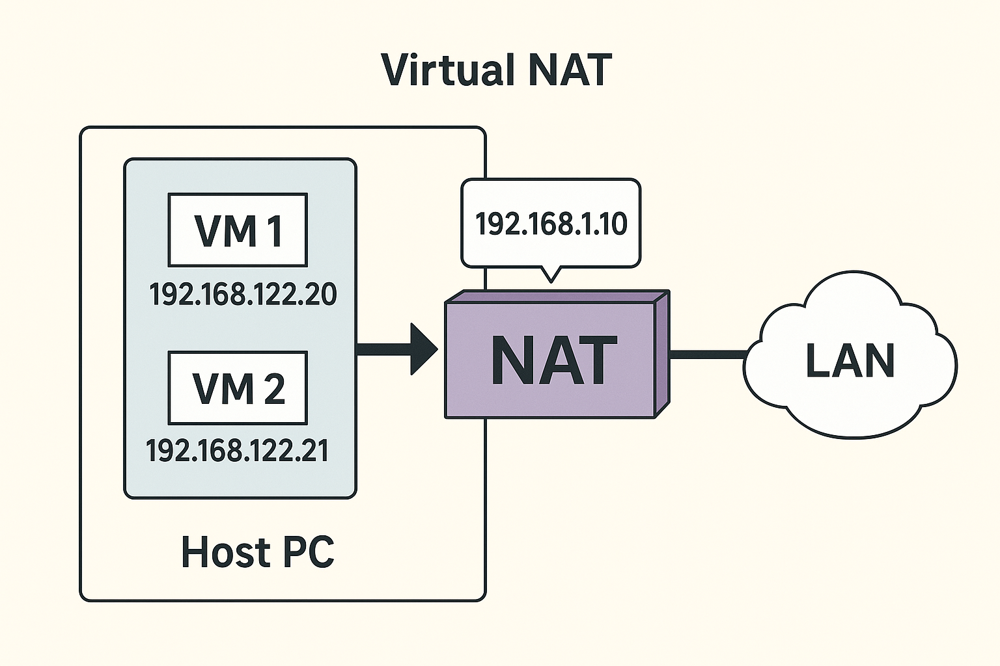
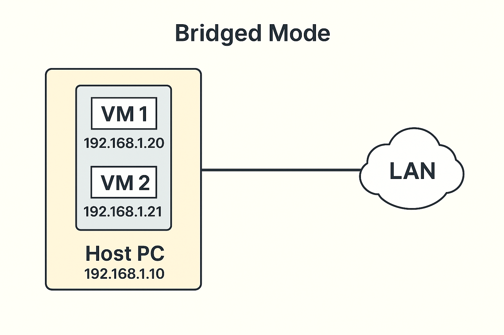

# Virtualisation

## Introduction 

For many activities and concepts through the year, we will utilise virtual machines to perform tasks. This allows us to experiment with system wide settings without risking the stability of our main operating system. 

Virtual machines (VMs) are a way of running another operating system (called the *guest*) within our main OS (called the *host*, almost like an application. We allocate a set amount of resources (CPU, RAM, storage) and install an operating system as we normally would on physical machine.

This brings benefits such as:

* **Improved security** - Applications running inside of the VM cannot directly interact with the host operating system. 
* **Testing** - When testing applications and code, using a VM prevents the software being tested from causing instability in the host machine if there any bugs. 
* **Experimentation** - Using VM allows the user to test different operating systems without having to fully reinstall their computer.

There are also some considerations to make when using virtual machines:

- **Speed** - As the VM is running within another operating system, it does suffer from a performance decrease due to what is called *overhead*, or the process of the VM accessing the host OS's hardware. 
- **Management** - When you have multiple virtual machines running, there needs to be considerations made for how to keep all guest operating systems up to date and security.

Guidance below is focused on how to use Virtual Machine Manager running on Fedora Linux as this is our lab setup. 

## Hypervisors

A hypervisor is a piece of software that runs and manages virtual machines, it works to allocate and balance system resources to maintain smooth operation. The also include features such as backups, clone VMs, and even running *containers*.

There are two types of hypervisor:

- **Type 1** - A type 1 hypervisor is a type of operating system the provides the sole function of creating and managing virtual machines. It handles all resources utilisation and is normally controlled through a web interface. For our servers, we use [Proxmox](https://www.proxmox.com). This is a Linux-based system that exclusively runs virtual machines and Linux containers (LXC).

    Type 1 hypervisors will generally have better performance that type 2 as they are not running a full desktop operating system alongside virtualisation software, however you lock-in to the hardware only being used for virtualising.

- **Type 2** - A type 2 hypervisor is a piece of software that runs within an operating system like an application. For example, Virtual Machine Manager is a type 2 hypervisor as it is an application that runs on top of the Linux operating system. 

    Type 2 hypervisors are a lot quicker and easier to setup than type 1, they are great for temporary use and experimentation however they do suffer from a reduction in performance.

## Installation

In the T-Lab environment, we actively use Fedora Linux which has been preconfigured with Virtual Machine Manager and Quick Emulator (QEMU). For who wish to virtualise on a Windows device, it is recommended that [VirtualBox](https://www.virtualbox.org/) is used. This is a free piece of software that operates very similarly but supports Windows. 

**To support with this activity, the below pages may be of use:**

* [Linux Package Management](../../misc/linux-package-management.md)
* [The GNU Nano Text Editor](../../misc/the-gnu-nano-text-editor.md)
* [Using Proxmox Virtualisation Servers](../../misc/using-proxmox-virtualisation-servers.md)

### Installation on Fedora Linux

1. Open a new terminal and install the following pieces of software:

```shell
sudo dnf install virt-manager qemu 
```

2. Next, we need to add our user account to the *libvirt* group to allow the use of virtualisation software:

```shell
sudo usermod -aG libvirt YourUsername
```

3. Finally, we need to enable to virtualisation service:

```shell
sudo systemctl enable --now libvirtd.service
```

For setting up a new installation of Fedora Linux in the T-Lab, you can use the following script to automatically configure a machine to be prepared for use. 

The scripts can be found on [Codeberg](https://codeberg.org/RDMillen/FedoraLabConfig/src/branch/main).

### Installation on Windows

Installing [VirtualBox](https://www.virtualbox.org/) on a personal machine is quite simple, download the Windows installer and run. 

## Hardware Allocation

The amount of system resources that you assign to a virtual machine (VM) will vary depending on a few factors. Such as: operating system of the VM, intended function, and number of clients the machine will need to support. Here are some suggested configurations for different use cases in the lab:

| VM Type                       | GUI | CPU Cores | RAM (Min)         | Disk Size | Use Case Examples                                   |
| ----------------------------- | --- | --------- | ----------------- | --------- | --------------------------------------------------- |
| **Windows 11 VM**             | Yes | 2–4       | 4096 MB           | 32 GB     | Testing GPOs, endpoint security, remote access      |
| **Windows Server – No GUI**   | No  | 2–4       | 4096 MB – 8192 MB | See below | AD DS, DHCP/DNS, PXE boot server                    |
| **Windows Server – With GUI** | Yes | 4+        | 8192 MB           | See below | GUI-based AD admin, WSUS, Print/File sharing        |
| **Linux – No GUI**            | No  | 2         | 2048 MB           | 16 GB     | SSH server, CLI scripting, web server, Docker       |
| **Linux – With GUI**          | Yes | 4         | 4096 MB           | 32 GB     | Kali Linux, GUI admin tools, graphical applications |

### Minimum Disk Allocation by Role (Windows Server)

- **AD DS only**: 40 GB
- **AD DS + WDS + MDT**: 60 GB
- **WSUS**: 100 GB+ (due to update caching)

## Networking

Virtual machines connect to the local area network (LAN) in one of two ways:

* *Virtual NAT* - The host machine creates a virtual network that assigns IP addresses to each virtual machine, packets are passed through to the host OS, and then forwarded onto the other devices. Read more on NAT here: [Network Address Translation (NAT)](networks/network-address-translation-nat.md)



* *Bridged Mode* - This allows the virtual machine to be seen on the LAN as an independent device, it will be assigned an IP address by the network's DHCP server. It is also visible to other devices on the network.



For *Occupational Specialism* tasks, we will use *Virtual NAT* to avoid interference with other students progression. For class practical tasks, or tasks using the Proxmox VMs, we will more commonly use *Bridged Mode*. 

If unsure, always ask as it will affect the behaviour of network services.

## Configuration

*To be completed*

## Troubleshooting

*To be completed*
