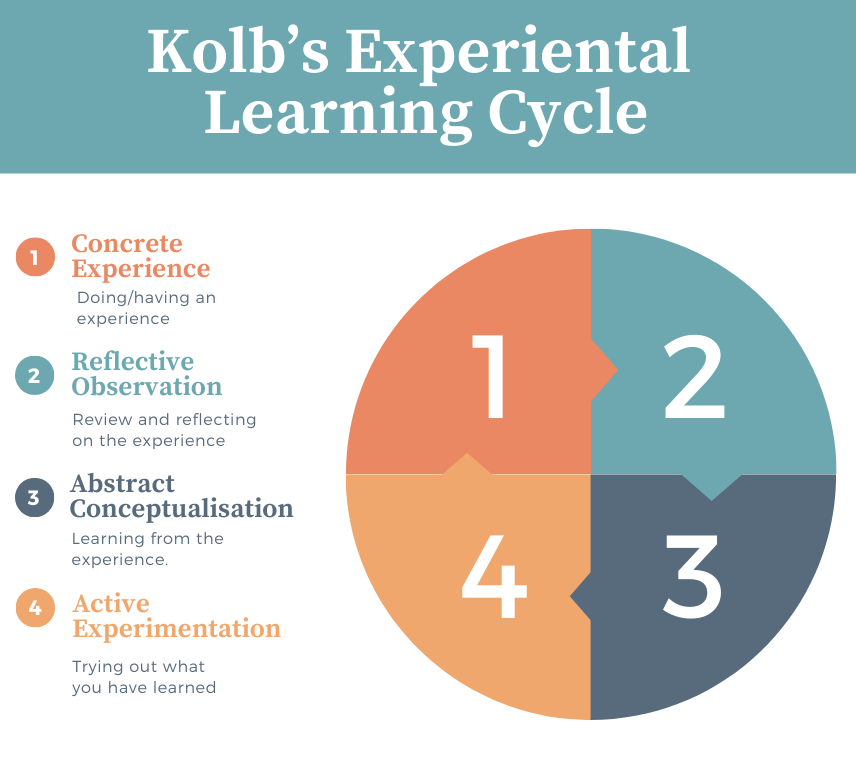

# Kolb's Experiential Learning Cycle

Kolb's model describes learning as a four-stage cycle:

1. **Concrete Experience** – doing/having an experience
2. **Reflective Observation** – reviewing and reflecting on the experience
3. **Abstract Conceptualisation** – learning from the experience
4. **Active Experimentation** – trying out what you have learned

This model encourages learners to reflect critically and apply their learning iteratively.

## Related Topics

- [Problem Solving](../index.md)
- Flowcharts in Problem Solving
